<div align="center">

<picture>
  <source media="(prefers-color-scheme: dark)" srcset=".github/assets/banner-dark.svg">
  
</picture>

**Real-time QR and barcode scanning with native camera previews.**<br>
CameraX and ML Kit on Android, AVFoundation and Vision on iOS, plus offline QR decoding and generation for images.

[](https://packagist.org/packages/pushinbr/pam-native-scanner)
[](https://github.com/push-in/pam-native-scanner/releases/latest)

[](https://github.com/push-in/pam-native-scanner/actions/workflows/ci.yml)
[](LICENSE)

[Install](#install) · [Quick example](#quick-example) · [Platforms](#platform-support) · [Permissions](#requirements) · [Docs](#docs) · [Issues](https://github.com/push-in/pam-native-scanner/issues)

</div>

<a id="install"></a>
## <picture></picture> Install

Inside a PAM Native project, add only this capability:

```sh
pam composer require pushinbr/pam-native-scanner
pam doctor --fix
```

New to PAM? Create a project with `pam init my-app --template native` (see the [PAM Native overview](https://push-in.github.io/pam-docs/native/overview/)), then come back here. Composer owns the manifest and the lockfile; `pam composer` runs it on PAM's verified PHP runtime.

<a id="quick-example"></a>
## <picture></picture> Quick example

```php
<?php

declare(strict_types=1);

use Pam\Native\Scanner\BarcodeFormat;
use Pam\Native\Scanner\ScannerView;
use Pam\Native\Scanner\ScanResult;

return ScannerView::make(BarcodeFormat::QrCode, BarcodeFormat::Ean13)
    ->duplicateInterval(1200)
    ->onResult(function (ScanResult $result): void {
        // Validate the value before navigation, network calls or payments.
    });
```

Declarative `.pam` components can use the same native view directly:

```xml
<QrScanner
    facing="1"
    duplicateInterval="1200"
    :enabled="$active"
    @detected="scanned"
    @failure="scannerFailed"
/>
```

The analyzer keeps only the latest frame, runs outside the UI thread, closes every image proxy and suppresses duplicate values for a configurable interval. Camera permission denial and native failures are typed events. Android uses the bundled ML Kit model, so first use does not depend on a model download.

<a id="platform-support"></a>
## <picture></picture> Platform support

| Platform | Support | Notes |
| --- | --- | --- |
| Android | API 26+ | CameraX 1.6.1, ML Kit barcode scanning 17.3.0 (bundled), ZXing Core 3.5.4 |
| iOS | 15.0+ | AVFoundation, Vision, ImageIO, Core Image |
| PAM Native | 0.8.0 to < 2.0.0 | From `pam-native.plugin.json`; PHP 8.5+ |

<a id="requirements"></a>
## <picture></picture> Permissions and requirements

| Platform | Declared by the plugin |
| --- | --- |
| Android | `android.permission.CAMERA` |
| iOS | `NSCameraUsageDescription` ("Scan QR codes and barcodes.") |

Camera usage metadata and Android permission merging are supplied by the plugin. Request camera permission before mounting an enabled scanner. Decoding and generating QR images (`QrImages`) does not need the camera permission.

<a id="qr-codes-in-images"></a>
## <picture></picture> QR codes in images

`QrImages::decode($uri, $complete, $failure)` decodes a local image (`pam-file:///...` from `Files::pick()`, granted `content://` or local `file://`) without opening the camera; remote URLs are rejected and up to 16 distinct QR values are returned. `QrImages::generate($text, $pixels, complete:, failure:)` renders a QR PNG offline, and `QrImages::release($uri)` frees it.

```php
QrImages::generate('https://example.test/profile', 440,
    complete: function (string $uri): void {
        // Display with Image::source($uri). Release when the image leaves the screen.
        QrImages::release($uri);
    },
    failure: function (string $message): void { /* Show a text/link fallback. */ },
);
```

Limits, cache rules and validation status: [docs/qr-images.md](docs/qr-images.md).

<a id="api-guide"></a>
## <picture></picture> API guide

| API | Responsibility |
| --- | --- |
| `ScannerView` | Render the native preview and configure scanning. |
| `BarcodeFormat` | Select only the barcode symbologies the product needs. |
| `ScanResult` | Receive value, format, and normalized scan data. |
| `ScannerEventKind` | Handle typed results, permission failures, and native errors. |
| `CameraFacing` | Select front or back camera. |
| `QrImages` | Decode QR codes in selected images and generate QR images. |

All coded states, kinds, and variants are sequential integer-backed enums. Use enum cases in application code; do not depend on raw wire numbers.

<a id="production-rules"></a>
## <picture></picture> Production rules

- Request camera permission before mounting an enabled scanner.
- Restrict formats to improve speed and reduce false positives.
- Validate scanned values before navigation, network calls, or payment actions.
- Run `pam doctor`, `pam test`, and a signed release build on every supported platform.
- Exercise denial, cancellation, backgrounding, process restart, and offline behavior before release.

Security vulnerabilities should be reported through the repository security policy or GitHub private vulnerability reporting, not a public issue.

<a id="troubleshooting"></a>
## <picture></picture> Troubleshooting

- **Preview is black:** verify permission, lifecycle visibility, and camera availability.
- **The same code fires repeatedly:** increase `duplicateInterval()`.
- **A format is never recognized:** include it explicitly in `make()`.
- **Native integration is stale:** run `pam doctor --fix`, rebuild the native host, and inspect the first reported diagnostic.

Platform SDKs, credentials, entitlements, physical hardware, and store configuration remain application responsibilities.

<a id="docs"></a>
## <picture></picture> Docs

- [PAM Native overview](https://push-in.github.io/pam-docs/native/overview/)
- [Plugin and native capability model](https://push-in.github.io/pam-docs/native/plugins/)
- [PAM introduction](https://push-in.github.io/pam-docs/introduction/)
- [Changelog](CHANGELOG.md)
- [Report an issue](https://github.com/push-in/pam-native-scanner/issues)
- [QR codes in selected images and QR generation](docs/qr-images.md)
- [Android development checks](docs/android-development.md)

<a id="pam-ecosystem"></a>
## <picture></picture> Part of the PAM ecosystem

<p align="center"><picture>
  <source media="(prefers-color-scheme: dark)" srcset=".github/assets/pam-wordmark-dark.svg">
  
</picture></p>

PAM runs PHP natively on servers, desktops and phones. This repository is one piece of it.

| [**PAM**](https://github.com/push-in/pam) | [**PAM Desktop**](https://github.com/push-in/pam-desktop) | [**PAM Native**](https://github.com/push-in/pam-native) | [**Ecosystem**](https://github.com/push-in/pam#ecosystem) |
| --- | --- | --- | --- |
| the runtime and CLI | native desktop apps in PHP | native Android and iOS apps in PHP | every official package and plugin |

<sub>Docs: [push-in.github.io/pam-docs](https://push-in.github.io/pam-docs/introduction/) · [Issues](https://github.com/push-in/pam-native-scanner/issues)</sub>

<p align="center"><sub><a href="LICENSE">Apache License 2.0</a> · Made in Brazil by Pushin</sub></p>
